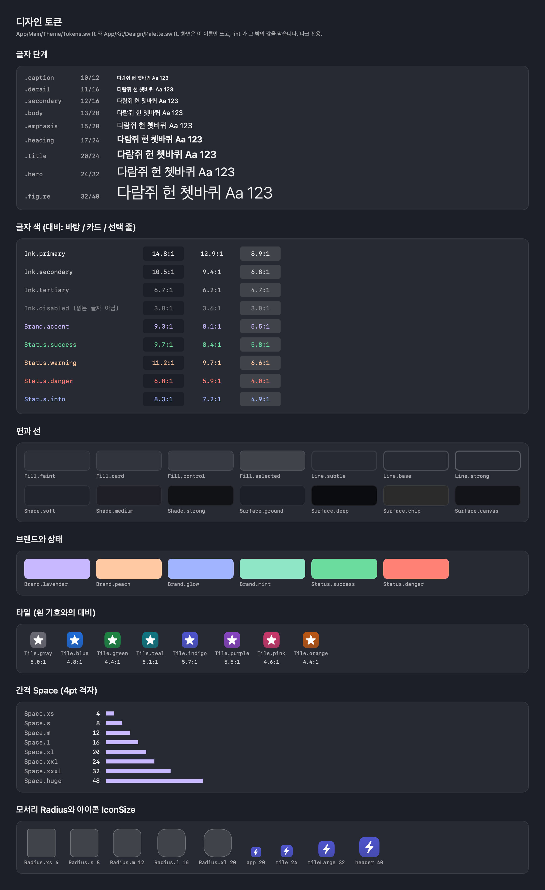

# Contributing

Thanks for helping. A few things make reviews quick:

- **Build and test before you push**: `scripts/build.sh --test` must pass without warnings, including the design lint (`scripts/lint-design.sh`). CI runs the same on every pull request.
- **Keep logic testable**: put pure logic (parsing, calculations, rules) in `App/Kit` with XCTest coverage. `App/Main` holds the app, system adapters and SwiftUI views and must not leak into `App/Kit` (no SwiftUI or AppKit UI imports there).
- **New features plug in as modules**: see [Adding a module](#adding-a-module). The launcher, the settings window and the menu bar only gather what modules declare; adding a feature should not require changing them.
- **Korean text in the UI, for now**: the interface is Korean. Write user-facing strings in plain Korean, the way the existing ones read. Localization (a String Catalog with English first) is welcome as its own pull request. Code, comments and commit messages may be English or Korean.
- **No administrator rights by default**: the app reads only what macOS allows without root. Anything that needs root goes through the charge helper's small, fixed command set — never by relaunching the app as root.
- **Minimum macOS is 26**: do not add fallbacks for older systems.
- **Privacy**: nothing leaves the Mac unless the user asked for it (AI questions) or can turn it off (public IP lookup, update check). No analytics.
- **Small, focused pull requests**: one feature or fix per pull request, with a screenshot for anything visible (a development build can draw its own windows: `--snapshot-settings <folder>`, `--show-panel <screen> --snapshot-window <folder> <seconds>`).

## Adding a module

Every feature (clipboard history, window snapping, the system monitor…) is a module the user can switch on and off in Settings → 기능. A new feature is one folder and one line:

1. **A folder** `App/Main/<Feature>/` with your code and a `<Feature>Module.swift` that conforms to `AppModule` (`App/Main/Modules/AppModule.swift`). Pure logic goes in `App/Kit/<Feature>/` with tests.
2. **One line** in `App/Main/Modules/ModuleRegistry.swift`. Its position is the feature's place in the settings and in a new install's menu bar.

The module declares itself in a `ModuleDescriptor` (`App/Kit/Modules/ModuleDescriptor.swift`):

```swift
@MainActor final class TimerModule: AppModule {
    nonisolated static let descriptor = ModuleDescriptor(
        id: "timer",                       // stable: the settings file uses it, never rename
        title: "타이머", summary: "메뉴 막대에서 남은 시간을 봅니다",
        symbol: "timer", tint: .orange,
        defaultEnabled: false,             // on for a new install?
        requires: [],                      // e.g. [LauncherModule.descriptor.id] if it lives in the launcher
        permissions: [],                   // macOS permissions it asks for; Settings → 권한 lists only those of running modules
        menuBarItems: [MenuBarItemDescriptor(id: "timer.remaining", moduleID: "timer", title: "남은 시간",
                                             symbol: "timer", styles: [.iconAndValue, .icon], defaultVisible: true)])
    var descriptor: ModuleDescriptor { Self.descriptor }

    init(host: ModuleHost) { /* keep `host` if you need settings, notices or the launcher */ }

    var commandSources: [CommandSource] { [source] }          // launcher commands and global shortcuts
    var menuBarItems: [MenuBarItem] { [/* glyph per style, a change publisher, a click */] }
    func settingsGroups(in environment: AppEnvironment) -> AnyView? { AnyView(TimerPane()) }  // groups only; nil: none
    func start() { /* timers, observers, taps */ }
    func stop() { /* undo everything start() did */ }
}
```

Rules that keep "off" meaning off:

- `start()` and `stop()` may be called more than once. After `stop()` nothing of the module may run: no timer, no observer, no open window, no system tap or helper connection. Saved data stays; switching back on finds it.
- Do the work in `start()`, not in `init`. `init` runs for every module, switched on or not.
- Ask for a permission only from a running module, at the moment the feature needs it.
- Global shortcuts come from your commands' `hotkeyID`s; the app registers them only while the module runs. Default keys go in `defaultHotkeys`.
- Menu bar items describe *what* to draw as `MenuBarGlyph` pieces (symbol, text, two stacked lines, graphs); `MenuBarRenderer` draws them, so every item looks at home and the settings preview matches the menu bar. Offer the styles that make sense (`.icon`, `.iconAndValue`, `.value`, `.graph`); the user picks one, the order, and whether items share one slot.
- Talk to the rest of the app through `ModuleHost` only. If another module is needed, ask `host.module(OtherModule.self)`, which is nil while it is off.
- Your settings page is drawn by the app in one shape for every module: the module header (tile, name, summary, on/off switch), then the groups you return from `settingsGroups(in:)`, then a 단축키 group with your commands' shortcuts (`settingsShortcutIDs` narrows it) and a 권한 group from `descriptor.permissions`. Return `SettingsSection`s made of the settings parts (`ToggleRow`, `PickerRow`, `SliderRow`, `FieldRow`, `ListRow`, `SettingsRow` + `RowButton`); do not draw your own header, permission cards or shortcut rows.
- Development-only flags of your feature go in `<Feature>DevelopmentAids.swift` as `runDevelopmentAid(_:)` inside `#if TOOLSMITH_DEV`. The app delegate has no feature-specific code.

## Design system



Every screen uses the tokens and parts in `App/Main/Theme`, so the app looks like one app. The sheet above is drawn by the app itself (`--render-tokens <png>` in a development build); redraw it when a token changes.

- **Palette** (`App/Kit/Design/Palette.swift`): every color as numbers: the ink ground, white steps, the brand (lavender, peach, glow, mint), status (success, warning, danger, info) and eight tile colors. `PaletteTests` checks contrast: reading text 4.5:1 on the ground, a card and a selected row; disabled text, white symbols on tiles 3:1.
- **Meaning tokens** (`App/Main/Theme/Tokens.swift`), the only colors screens use: `Ink` (text: primary, secondary, tertiary, disabled, onAccent), `Fill` (faint, card, control, selected), `Line` (subtle, base, strong), `Shade`, `Surface`, `Brand` (accent…), `Status`, `Tile`, and `Tint` to lay a color thinly (wash, edge, light, strong).
- **Type** by role: `.font(.role(.body))`, or `.textRole(.detail)` for text that wraps. Roles on whole points: caption 10, detail 11, secondary 12, body 13, emphasis 15, heading 17, title 20, hero 24, figure 32, each with a weight and a line height. A call may make a role heavier (`weight:`) or set a design for numbers (`.rounded`, `.monospaced`).
- **Space** on a 4-point grid (xs 4, s 8, m 12, l 16, xl 20, xxl 24, xxxl 32, huge 48), **Radius** xs 4, s 8, m 12, l 16, xl 20, **IconSize** app 20, tile 24, tileLarge 32, header 40.
- **Parts** (`Components.swift`, `Controls.swift`): `Card`, `Panel`, `PanelHeader`, `TableRow`, `Figure`, `IconTile`, `KeyCap`/`KeyCaps`, `Notice`, `EmptyState`, `Badge`, `RowButton`, `RowSwitch`, `LabeledSwitch`, `RowMenu`, `Segmented`, `IconButton`, `FooterButton`, `Spinner`, `PermissionCard`, `TrackSwitch`, `TrackSlider`, `LevelMeter`. Switches and sliders are drawn by the app: the system ones turn grey whenever the app is not in front.
- **Settings parts** (`SettingsParts.swift`): `SettingsPage`, `SettingsSection`, `SettingsRow`, `ToggleRow`, `PickerRow`, `SliderRow`, `FieldRow`, `ListRow`, `ActionsRow`, `ContentRow` (only for content that is not a row, like a chart), `ModuleHeader`. Shortcut rows are `HotkeyRow`.
- The app is dark only: its surfaces are dark glass, the approved look. A light mode would be a second design, not a second set of values.

`scripts/lint-design.sh` (run by `scripts/build.sh` before building) rejects, outside `App/Main/Theme`: font sizes (`.system(size:)`, `NSFont.systemFont(ofSize:)`), colors written as numbers or made transparent by hand, system color names where a palette color exists, corner radii and spacing as numbers, `.controlSize`, `Toggle` and `Picker` used directly. Files that paint pixels with AppKit (the menu bar renderer, capture overlays, annotations) are named in the script and not checked. To need something new, add it to the palette or the tokens first.

## The menu bar panel

Menu bar items open one panel. A module adds pages to it with `panelScreens` (`App/Main/MenuBar/PanelScreen.swift`): an id, a title, a symbol, a width (340 is the usual), the settings page its gear opens, and the content. The panel draws the head (title, pin, settings), the switcher between screens and the footer; the screen draws its own content only and is as tall as it needs. Use `onShow`/`onHide` for work that should run only while the screen is visible, and `auxiliaryWindows` for windows it opens beside the panel. An item opens its screen with `host.openPanel(id, below: frame)`.

## Development builds

`scripts/build.sh` builds the development configuration, which adds command-line aids (see `runDevelopmentAid` in each module and `ToolsmithApp.swift`). Start a development build with `TOOLSMITH_SUPPORT_DIR=<empty folder>` to keep its settings and history away from an installed copy. Contributors' notes for people and coding agents are in [CLAUDE.md](CLAUDE.md).

For larger changes, open an issue first so we can agree on the approach.
