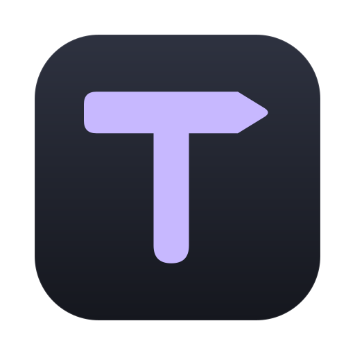
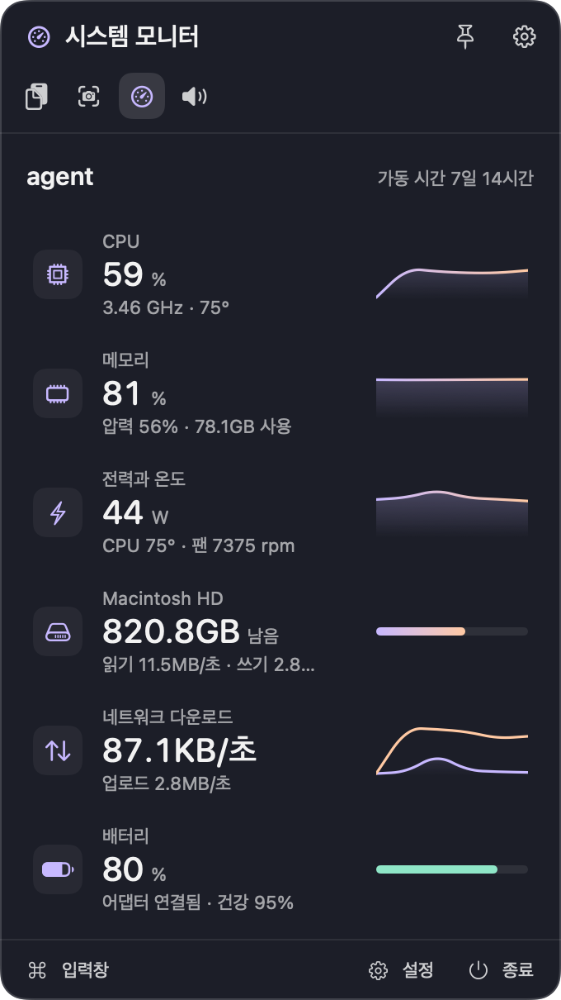

<p align="center">
  
</p>

<h1 align="center">Toolsmith</h1>

<p align="center">
  실제로 쓰는 맥 유틸리티만 골라 끼워 쓰는 작은 네이티브 앱.<br>
  기능을 켜고 끄고, 메뉴 막대에 보일 것을 고르고, 필요한 기능은 직접 붙입니다.
</p>

<p align="center">
  <a href="README.md">English</a> · <b>한국어</b>
</p>

<p align="center">
  <!-- 스크린샷: 메뉴 막대 패널의 시스템 모니터, 옆에 자세히 보기 -->
  
</p>

## 왜 만들었나

구독형 유틸리티 묶음에는 앱이 수십 개 들어 있습니다. 어떤 것은 필요한 일을 거의 하지만 조금 모자라고, 어떤 것은 필요 이상으로 많은 일을 하고, 모두 매달 돈이 나갑니다. Toolsmith 는 그 반대입니다. 앱은 하나이고, 기능은 켜고 끄는 모듈이며, 어떤 기능이든 고치거나 늘릴 수 있게 소스가 열려 있습니다. 끈 기능은 정말로 아무것도 하지 않습니다. 백그라운드 작업, 권한 요청, 단축키, 메뉴 항목 모두 없습니다.

## 기능

모든 기능은 설정 → 기능 에서 끌 수 있는 모듈입니다.

- **입력창.** 어디서든 <kbd>⌥</kbd> <kbd>Space</kbd> 로 어두운 유리 입력창을 띄웁니다. 앱을 열고, 동작을 이름으로 찾아 실행하고(초성 검색 됨), <kbd>⌘</kbd> + 숫자로 그 줄을 바로 실행합니다. 모든 단축키를 바꿀 수 있습니다.
- **클립보드 기록.** <kbd>⌥</kbd> <kbd>V</kbd> 로 복사한 글, 링크, 그림, 파일을 미리보기와 함께 엽니다. 찾고, 고정하고, 쓰던 앱에 붙입니다. 비밀번호, 제외한 앱, 아이폰에서 복사한 것은 남기지 않습니다. 기록은 직접 지우거나 보관 기간을 정할 때까지 이 맥에만 남습니다.
- **스니펫.** 자주 쓰는 문장을 저장해 쓰던 앱에 바로 붙입니다. `{이름}` 을 넣으면 붙일 때 값을 묻습니다.
- **화면 나누기.** 절반, 3분의 1, 4분의 1, 가운데, 다음 화면, 되돌리기 등 18가지 배치를 입력창이나 단축키로.
- **화면 캡처와 녹화.** 영역, 창, 전체 화면, 스크롤 캡처, 주석, 글자 인식, 색 고르기, 픽셀 자, MP4 와 GIF 녹화.
- **AI 답변.** 입력창에서 <kbd>.</kbd> 을 치고 물으면 웹을 검색해 출처와 함께 답합니다. 본인의 [OpenRouter](https://openrouter.ai) 키를 키체인에 두고 씁니다.
- **시스템 모니터.** 메뉴 막대에 CPU, 메모리, 디스크, 네트워크, 배터리, 온도와 전력. 패널에서는 코어별 부하, 많이 쓰는 앱, 전원 흐름, 센서, Wi-Fi·VPN, 28일까지의 기록.
- **사용 시간.** 앱마다 얼마나 썼는지 시간대별, 주간으로. 이 맥에만 기록하고 90일 뒤 지웁니다.
- **배터리 충전 제한.** 80~95% 에서 충전을 멈추거나 이번만 끝까지 충전합니다. macOS 26.4 이상 애플 실리콘 맥에서는 macOS 자체의 충전 제한을 씁니다.

### 하나의 메뉴 막대 패널

메뉴 막대의 어느 항목을 눌러도 같은 패널이 그 기능 화면으로 열립니다(모니터, 최근 복사, 캡처 동작). 어떤 항목을 어떤 순서와 모양(아이콘, 수치, 그래프)으로 보일지, 한 칸으로 묶을지를 설정 → 메뉴 막대 에서 미리보기를 보며 고릅니다.

<!-- 스크린샷: 설정 → 기능, 설정 → 메뉴 막대 -->

## 설치

**macOS 26 이상**, **애플 실리콘** 맥이 필요합니다.

[Homebrew](https://brew.sh) 로 설치:

```sh
brew tap kimjisub/tap
brew trust kimjisub/tap   # Homebrew 는 다른 사람의 tap 을 한 번 믿어 달라고 합니다
brew install --cask toolsmith
```

직접 설치:

1. [Releases](https://github.com/kimjisub/toolsmith/releases) 에서 최신 `Toolsmith-<버전>.dmg` 를 받습니다.
2. 열어서 **Toolsmith** 를 응용 프로그램 폴더로 끌어 놓습니다.
3. 실행하면 짧은 안내가 손쉬운 사용(화면 나누기와 붙여넣기)과 선택 권한을 묻습니다.

배포판은 Developer ID 로 서명하고 애플 공증을 받았으며, 이 저장소의 릴리스에서 스스로 업데이트합니다(설정 → 정보 에서 끌 수 있습니다).

## 개인정보

- 앱이 기록하는 것(클립보드 기록, 스니펫, 사용 시간, 모니터 기록, 설정)은 모두 `~/Library/Application Support/kim.jisub.toolsmith` 에만 있고 본인만 읽을 수 있습니다.
- 네트워크: AI 질문은 물을 때만 OpenRouter 로, 네트워크 자세히 보기는 공인 IP 를 Cloudflare 에 물을 수 있고(끌 수 있음), 업데이트 확인은 이 저장소의 릴리스를 읽습니다. 그 밖에는 맥 밖으로 나가는 것이 없고, 사용 통계도 없습니다.
- 시스템 모니터는 관리자 권한 없이 macOS 가 허락하는 것만 읽습니다. 예전 맥을 위한 충전 도우미는 직접 설치할 때만 돌고, 정해진 명령만 받습니다.

## 소스에서 빌드

```bash
brew install xcodegen
scripts/build.sh --test          # 개발 빌드와 테스트
open build/Release/Toolsmith.app
scripts/build.sh --release       # 배포와 같은 빌드(개발 도구 없음)
```

Xcode 프로젝트는 `project.yml` 에서 만들어집니다. 순수 로직은 `App/Kit`(XCTest), 앱과 화면은 `App/Main`, 충전 도우미는 `App/Helper` 에 있습니다.

직접 서명해 나눠 주려면 `project.yml` 맨 위의 신원 묶음(`APP_NAME`, `APP_BUNDLE_ID`, `APP_TEAM_ID`, `APP_UPDATE_REPOSITORY`, `APP_COPYRIGHT`)을 바꾸고 `scripts/release.sh` 에 서명 자격을 줍니다([docs/release.md](docs/release.md)).

## 기능 붙이기

기능 하나는 폴더 하나와 `ModuleRegistry` 한 줄입니다. 설정 칸, 단축키, 권한 목록, 메뉴 막대는 모듈이 밝힌 것에서 저절로 따라옵니다. 모듈 안내와 디자인 시스템은 [CONTRIBUTING.md](CONTRIBUTING.md) 에 있습니다.

## 기여

이슈와 풀 리퀘스트를 환영합니다. [CONTRIBUTING.md](CONTRIBUTING.md) 를 보세요. 보안 문제는 [SECURITY.md](SECURITY.md) 에 적힌 대로 비공개로 알려 주세요.

## 라이선스

[MIT](LICENSE) © 2026 Jisub Kim
