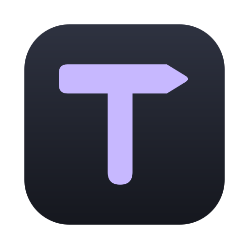
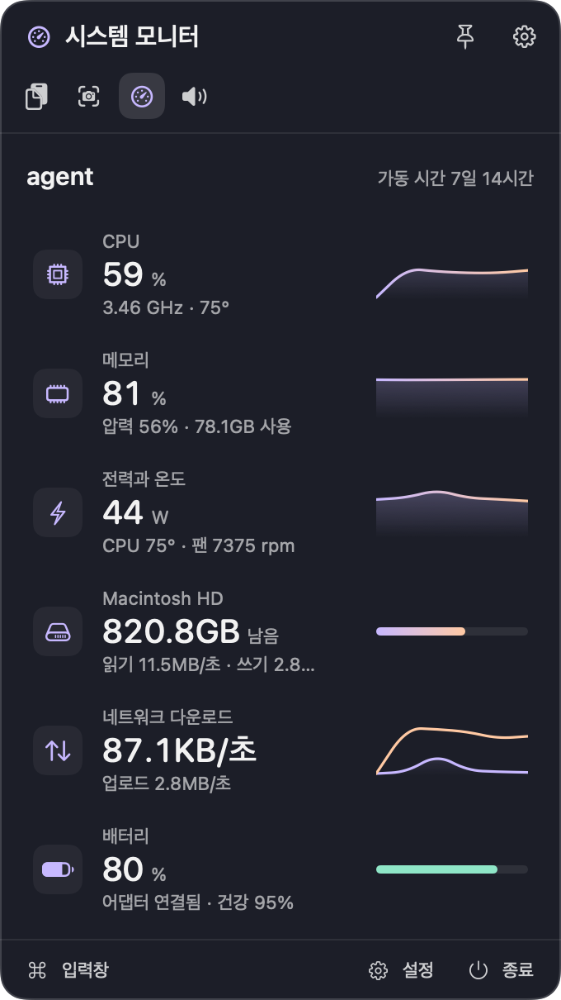

<p align="center">
  
</p>

<h1 align="center">Toolsmith</h1>

<p align="center">
  The Mac utilities you actually use, in one small native app you put together yourself.<br>
  Switch features on or off, choose what the menu bar shows, add your own.
</p>

<p align="center">
  <b>English</b> · <a href="README.ko.md">한국어</a>
</p>

<p align="center">
  <!-- screenshot: the menu bar panel on the system monitor, details open beside it -->
  
</p>

## Why

Utility subscriptions bundle dozens of apps. Some of them almost do what you need; others do far more than you need; all of them cost every month. Toolsmith is the other way round: one app, the features as modules you switch on, and the source to change or extend any of them. A feature that is off does nothing at all: no background work, no permission prompts, no shortcuts, nothing in the menus.

> The interface is in Korean for now. Translations are welcome.

## Features

Every feature is a module you can turn off in Settings → 기능.

- **Launcher.** Press <kbd>⌥</kbd> <kbd>Space</kbd> anywhere for a dark glass prompt. Open apps, run any action by name (Korean initial-consonant search works), press <kbd>⌘</kbd> + a number to run a row. Every shortcut can be reassigned.
- **Clipboard history.** <kbd>⌥</kbd> <kbd>V</kbd> opens everything you copied: text, links, images and files, with previews. Search, pin, paste into the app you were in. Passwords, apps you exclude and copies from your iPhone are never recorded. History stays on your Mac until you clear it or choose a period.
- **Snippets.** Save messages you write again and again and paste them into the app in use. Put `{name}` in the text and you are asked for the value when you paste.
- **Window snapping.** 18 layouts (halves, thirds, quarters, center, next display, restore) from the launcher or shortcuts.
- **Screen capture and recording.** Area, window, full-screen and scrolling captures, annotation, text recognition, color picker, pixel ruler, MP4 and GIF recording.
- **AI answers.** Type <kbd>.</kbd> in the launcher to ask a question; answers are searched on the web and cite their sources. Uses your own [OpenRouter](https://openrouter.ai) key, kept in the Keychain.
- **System monitor.** CPU, memory, disk, network, battery, temperature and power in the menu bar; per-core load, top apps, power flow, sensors, Wi-Fi/VPN details and history up to 28 days in the panel.
- **Screen time.** How long you spent in each app, by hour and over the week. Recorded only on your Mac, deleted after 90 days.
- **Battery charge limit.** Stop charging at 80–95%, or charge to full just once. Uses macOS's own limit on macOS 26.4 and later (Apple silicon).

### One menu bar panel

Every menu bar item opens the same panel on its feature's page: the monitor, the latest copies, capture actions. Choose which items show, their order, their style (icon, value, graph) and whether they share one slot, with a live preview in Settings → 메뉴 막대.

<!-- screenshot: Settings → 기능 and Settings → 메뉴 막대 -->

## Install

Requires **macOS 26 or later** on **Apple silicon**.

1. Download the latest `Toolsmith-<version>.dmg` from [Releases](https://github.com/kimjisub/toolsmith/releases).
2. Open it and drag **Toolsmith** to Applications.
3. Launch it. A short guide asks for Accessibility (window snapping and pasting) and the optional permissions.

Releases are signed with a Developer ID and notarized by Apple, and update themselves from this repository's releases (Settings → 정보 can turn that off).

## Privacy

- Everything the app records (clipboard history, snippets, screen time, monitor history, settings) stays under `~/Library/Application Support/kim.jisub.toolsmith`, readable only by you.
- Network: your AI questions go to OpenRouter only when you ask; the network details may ask Cloudflare for your public IP (can be turned off); the update check reads this repository's releases. Nothing else leaves your Mac. No analytics.
- The system monitor reads only what macOS allows without administrator rights. The charge-limit helper for older Macs is opt-in and runs only the commands it understands.

## Build from source

```bash
brew install xcodegen
scripts/build.sh --test          # development build + tests
open build/Release/Toolsmith.app
scripts/build.sh --release       # what users get (no development aids)
```

The Xcode project is generated from `project.yml`. Pure logic lives in `App/Kit` with XCTest coverage; the app and its UI in `App/Main`; the charge helper in `App/Helper`.

To distribute your own signed build, change the identity block at the top of `project.yml` (`APP_NAME`, `APP_BUNDLE_ID`, `APP_TEAM_ID`, `APP_UPDATE_REPOSITORY`, `APP_COPYRIGHT`) and pass your signing identity to `scripts/release.sh` (see [docs/release.md](docs/release.md)).

## Add a feature

A feature is one folder and one line in `ModuleRegistry`. The settings page, the shortcuts, the permission list and the menu bar follow from what the module declares. See [CONTRIBUTING.md](CONTRIBUTING.md) for the module guide and the design system.

## Contributing

Issues and pull requests are welcome; see [CONTRIBUTING.md](CONTRIBUTING.md). Report security problems privately as described in [SECURITY.md](SECURITY.md).

## License

[MIT](LICENSE) © 2026 Jisub Kim
